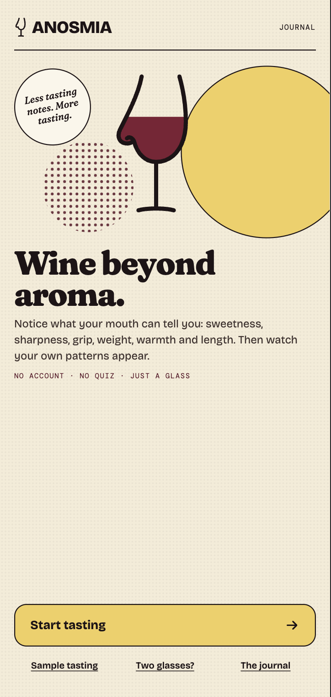
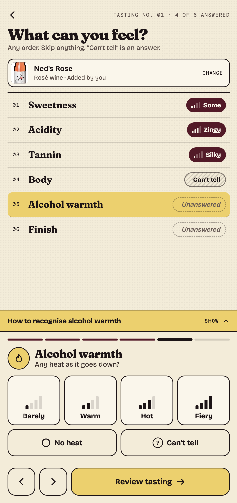
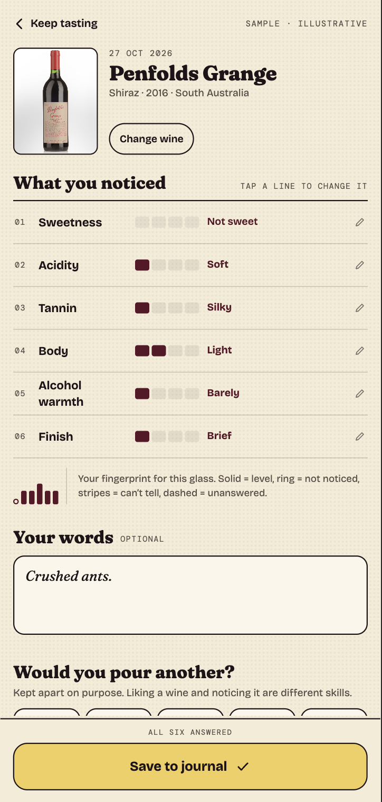

# ANOSMIA — Wine Beyond Aroma

**A sensory-learning wine journal, including for people who find aromas difficult to detect.** Explore what you can perceive in a glass of wine, record your observations, and look back at how those perceptions change over time.

**Open Anosmia:** https://anosmia.vercel.app/

No account or installation is required to use it in a desktop or mobile browser.

## Screenshots

<p align="center">
  
  
  
</p>

## Use on a desktop computer

1. Open **https://anosmia.vercel.app/** in your browser.
2. Select **Start tasting** and follow the recording flow.
3. Use **How to recognise…** for guidance on each sensation.
4. Save your tasting to **The Cellar Book** (your journal). You can revisit entries and compare wines.

You can also try the [sample demonstration](https://anosmia.vercel.app/?demo). **Demo mode** is a fixed-size presentation with sample entries; it is not your personal journal and does not save tastings.

## Install on an Android phone

Using **Chrome** (recommended):

1. Open **https://anosmia.vercel.app/** in Chrome.
2. Open Chrome's **⋮** menu.
3. Choose **Install app** or **Add to Home screen** (wording varies).
4. Confirm the installation.
5. Launch **Anosmia** from your home screen or app drawer.

Use the normal URL **without `?demo`** for your journal. If the install option isn't offered, you can still use the app in Chrome.

## Add to an iPhone home screen

1. Open **https://anosmia.vercel.app/** in **Safari**.
2. Tap **Share**.
3. Choose **Add to Home Screen** (you may need to scroll through the actions).
4. Confirm **Add** and open Anosmia from your home screen.

Depending on your iOS version, you may see **Open as Web App**; enable it if offered. The app's Android testing is more extensive than its iPhone testing, so report any iOS-specific problems you encounter.

## How a tasting works

Anosmia records six sensations: **sweetness, acidity, tannin/astringency, body, alcohol warmth and finish**. You can record an intensity, choose **Not noticed** or **Can't tell**, or leave a sensation unanswered. There's no pressure to identify something you can't perceive.

You can take or select an optional label photograph, or leave the wine unidentified and add its details later. Once a tasting is saved, its **sensory observations, original notes, enjoyment rating and date cannot be changed**. Wine identity and the photograph can be corrected afterwards. A later tasting creates a new record so your history stays meaningful.

## Offline use and your data

Anosmia is **local-first**: saved tastings and their photographs are stored on the device and in the browser or installed app's local storage. After the app has loaded and its offline files are cached, you can reopen your journal and record tastings without a connection.

**Important:** There is currently **no account sync, backup or journal export**. Your entries are *not* automatically available on other devices or browsers. Clearing site data, uninstalling the app, changing devices or losing local storage can permanently delete your journal and photos. Avoid clearing Anosmia's site data if you want to keep them.

An installed app may initially show a previously cached version after an update. Reopen it while online to allow the new version to install; avoid clearing site data as an update workaround.

## Run the source locally (developers)

Requires a compatible recent Node.js release and npm.

```bash
npm install
npm run dev
```

Open the local URL printed by Vite (usually **http://localhost:5173/**). To test a production build locally:

```bash
npm run build
npm run preview
```

The preview normally runs at **http://localhost:4173/**. Use the root path, not `?demo`, to test real persistence. Local data is separate from data stored under the Vercel website's origin.

## Feedback

Anosmia is an evolving prototype, not a medical diagnostic or treatment tool. If you encounter a usability issue, include your device, browser and a brief description of what happened. **Do not share private journal data or photographs unless you choose to.**
